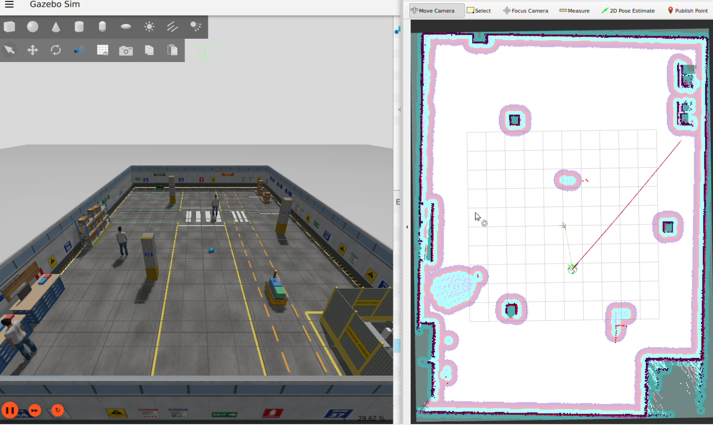
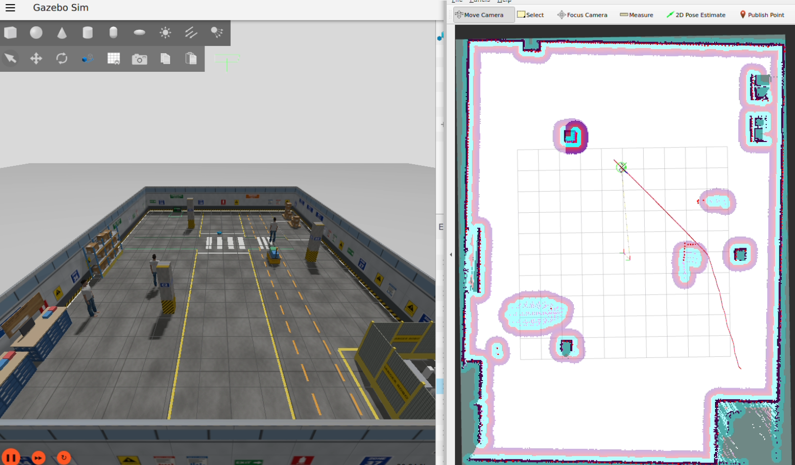

# vio-autonomy-ros2

[](https://github.com/VasuTammisetti/vio-autonomy-ros2/actions/workflows/ci.yml)

A ROS 2 (Jazzy) robot that patrols a simulated factory hall while people and a tugger cart move around it. It localizes with LiDAR, an RGB-D camera, an IMU and wheel odometry, tracks the people and the cart, predicts where they are going a few seconds ahead, and plans around that with Nav2. Every velocity command goes through a safety gate before it reaches the wheels. Once started, it runs the patrol on its own.

Runs in Gazebo Harmonic on Ubuntu 24.04 under WSL2.

<p align="center">
  
</p>
<p align="center">
  
</p>
<p align="center"><sub>Gazebo on the left, RViz on the right. The red line is the Nav2 plan. The cyan patches around the people and the cart include their predicted positions.</sub></p>

## The setup

The hall is 20 x 15 m with a main aisle, a zebra crossing, a cart lane, three pillars, benches and racks. Three people and a cart move around the whole time. One uses the zebra crossing, one cuts across the aisle wherever, one works at the benches, and the cart drives up and down its lane and waits at crossings if someone is close. They also react to the robot. They stop if it's in their way, and if it's still there after a few seconds they step aside.

The robot patrols four stations (assembly, loading bay, charging, QA). If a leg fails it clears the costmaps and tries again, up to three times. Every leg is written to a CSV in `logs/`.

## Results

2 laps on 11 Oct with everything switched on. This is the run in the demo video.

| Lap | Station | Result | Attempts | Sim time | Closest agent |
|---|---|---|---|---|---|
| 1 | assembly | reached | 1 | 37.7 s | 0.78 m |
| 1 | loading_bay_1 | reached | 1 | 62.8 s | 0.91 m |
| 1 | charging | reached | 3 | 49.3 s | 1.60 m |
| 1 | qa_cell | reached | 3 | 74.5 s | 0.93 m |
| 2 | assembly | reached | 2 | 42.1 s | 1.38 m |
| 2 | loading_bay_1 | failed, moved on | 3 | 26.9 s | 1.42 m |
| 2 | charging | reached | 2 | 54.7 s | 0.90 m |
| 2 | qa_cell | reached | 1 | 83.3 s | 0.89 m |

7 of 8 legs made it. The closest any agent got was 0.78 m, and the gate never had to go into HOLD. Before I fixed the agents (see below) the same patrol had people at 0.09 m from the robot.

Not solved yet: a few attempts failed within seconds without Nav2 trying any recovery, and I don't know why yet. On 9 Oct, before the VIO and agent changes, every leg of a lap went through on the first try.

### Odometry drift

To see what the camera adds, I set the wheel radius 10% wrong on purpose, drove a 3 x 3 m square (12 m) and measured how far the EKF drifted, with LiDAR localization on the saved map as the reference (`tools/drift_test.py`).

| Heading from | Visual odometry | Worst position error | Heading error at end |
|---|---|---|---|
| wheels | off | 0.92 m | -21.0 deg |
| wheels | on | 0.75 m | -16.3 deg |
| gyro | off | 0.44 m | -0.2 deg |
| gyro | on, with lag smoothing | 0.42 m | -0.6 deg |

Most of the improvement came from fixing the EKF config, not from the camera. It was taking heading from the wheels and mostly ignoring the gyro. With heading from the gyro, the spin test (two full turns, correct wheels) went from +4.6 deg error to -0.1 deg. On top of that the camera made no real difference in this hall. 0.42 vs 0.44 m is within the noise. It's one run per setting, so I wouldn't read much into small differences.

## How it fits together

```
Sensors        2D LiDAR (20 m), RGB-D camera (640x480, 10 Hz), IMU, wheel encoders
   |
Localization   robot_localization EKF
                 wheels: x, y (differential)   gyro: yaw rate   VO: x, y, yaw (rtabmap)
               slam_toolbox localization on the saved map: map -> odom
   |
Perception     /fused_objects (people and carts in the map frame)
   |
World model    one Kalman filter per agent, constant velocity, 5 s forecast
   |
Planning       Nav2: NavFn + DWB
               costmaps: static + LiDAR obstacles + forecast layer (STVL, 1 s decay)
   |
Safety gate    state machine on the nearest agent, direction aware
   |
Robot          ros2_control diff_drive_controller
```

Each box is its own node and they only talk over topics, so the world model doesn't know or care whether `/fused_objects` comes from the simulator or from a real detector.

### VIO

Loosely coupled. rtabmap's `rgbd_odometry` estimates motion from the RGB-D camera (2D only, `src/my_robot/config/vo.yaml`), and the EKF fuses that with the gyro and the wheels.

`tools/vo_relay.py` sits in between. rtabmap reports an uncertainty of about 0.3 mm, which the EKF would just believe, so the relay replaces it with 2 cm and 0.01 rad. It also drops frames where tracking was lost and ignores jumps bigger than 0.15 m or 0.3 rad.

VO messages arrive 150 to 200 ms after the image was taken. By default robot_localization throws away measurements older than its last update, so it was ignoring almost all of them. `smooth_lagged_data` with 1 s of history fixed that.

On its own VO was within -1 to +3 deg over two spins and 2 to 4% short over 2 m, with no tracking losses. The camera runs at 10 Hz now (the drift tests were done at 20 Hz). Where VO should really pay off is a long featureless aisle or wheels that slip, and I haven't tested that yet.

### World model

`tools/world_model_node.py` keeps one constant-velocity Kalman filter per agent (nearest neighbour association with a 1 m gate) and predicts 10 steps of 0.5 s ahead. There are no measurements in the forecast, so the uncertainty grows with every step. `prediction_costmap_bridge.py` puts the first 3 s of each forecast into a separate STVL layer in both costmaps. Points in that layer decay after 1 s, so old predictions don't stay behind as ghost obstacles.

### Safety gate

`tools/safety_gate.py` sits between Nav2 and the wheels and looks at the nearest tracked agent.

| State | Distance | What it does |
|---|---|---|
| AUTONOMOUS | over 1.5 m | passes commands through |
| DEGRADED | under 1.5 m | 40% speed |
| SAFE_STOP | under 0.9 m | no motion towards the agent, but turning, backing off and driving past are allowed at half speed |
| HOLD | under 0.5 m | same as SAFE_STOP, releases once the zone has been clear for 1 s |

The first version just stopped when someone got close, and then the robot and a person would stand there waiting for each other. Now it only blocks motion towards the person, so the robot can still back off, turn or carry on past. There's also a supervised mode (`REQUIRE_APPROVAL = True`) where leaving HOLD needs `ros2 service call /safety/approve std_srvs/srv/Trigger`.

This is not a safety function. A real robot needs a certified safety scanner and a hardwired e-stop (ISO 3691-4). The gate is an extra layer on top of that.

## Problems I solved

Every fix here started with a measurement. I'd usually guessed the cause first and been wrong at least once, so the tools in `tools/` exist to settle it.

| Problem | How I found the cause | Fix | Result |
|---|---|---|---|
| SLAM map came out smeared | `odom_check.py`: the EKF over-counted a 720 deg spin by 28.7 deg because the controller reported its turn rate 6% too high | fuse the wheel pose in differential mode instead of the twist | spin error 28.7 deg to 5.6 deg |
| map still smeared at starts and stops | `tilt_check.py`: the robot tipped back 19.5 deg when accelerating, it only had a front caster | rear caster with low friction | pitch 0.01 deg, spin error under 1 deg, clean map |
| all Nav2 servers died on startup (exit -6) | log said "Will not support aliasing": the generated nav2_params.yaml had YAML aliases | write the params file without aliases, plus a CI test | Nav2 starts every time |
| robot blocked by predictions that were no longer true | forecasts in the obstacle layer stayed there after the person had moved on | own STVL layer with 1 s decay, patrol stations moved at least 2 m from agent routes | full lap with every leg first try (9 Oct) |
| robot and a person froze facing each other | the gate blocked every motion, including backing off | direction-aware gate: only motion towards the person is blocked | no more standoffs, HOLD clears by itself |
| 21 deg heading drift with miscalibrated wheels | `drift_test.py` with a deliberate 10% wheel error: the EKF followed wheel yaw and mostly ignored the gyro | heading from the gyro only | drift 0.92 m to 0.44 m, heading error 21 deg to 0.2 deg |
| visual odometry had almost no effect | rtabmap's log showed each VO message is 150 to 200 ms old, and the EKF dropped late measurements | `smooth_lagged_data` with 1 s of history | VO now reaches the EKF (no clear accuracy gain in this hall, see above) |
| people walked into the robot (0.09 m) | `tf2_echo map odom` showed odometry had drifted 1.6 m from the map, and the agents used odometry to find the robot | agents use the map position from TF | closest approach 0.78 m, HOLD never needed |
| Gazebo at 18% of real time, windows freezing | `top` and `glxinfo`: WSL rendered on the CPU (llvmpipe), not the RTX 2070 | `GALLIUM_DRIVER=d3d12`, fewer pose updates, camera 20 to 10 Hz | real time factor 0.37, CPU about 78% idle |

## Running it

```bash
cd ~/autonomy
colcon build --symlink-install
source install/setup.bash

# Gazebo, EKF, SLAM localization, VO, Nav2, world model, safety gate, agents, RViz
ros2 launch src/my_robot/launch/bringup_all.launch.py

# after about 45 s
python3 tools/mission_runner.py --laps 2
```

| Launch argument | Default | |
|---|---|---|
| `use_agents` | true | move the people and the cart, publish `/fused_objects` |
| `use_predictions` | true | put forecasts into the costmaps |
| `use_vo` | true | run rtabmap VO and fuse it in the EKF |
| `use_mission` | false | start the patrol from the launch file |

Mission logs end up in `logs/mission_<time>.csv`.

The measurement scripts are in `tools/`, and each has a short header on how to run it:

- `odom_check.py` spins twice and drives 2 m, then compares wheels, IMU, EKF and VO against LiDAR scan alignment
- `tilt_check.py` logs pitch and roll during hard starts and stops
- `drift_test.py --label NAME` and `drift_summary.py` produce the drift table above
- `set_wheel_error.py 1.10` puts in a wheel calibration error, `set_wheel_error.py 1.0` takes it out again

On WSL2, check `glxinfo -B`. If it says llvmpipe, add `export GALLIUM_DRIVER=d3d12` and `export MESA_D3D12_DEFAULT_ADAPTER_NAME=NVIDIA` to `~/.bashrc`.

The paths in `bringup_all.launch.py` point to `/home/vasu0/autonomy`, so change `HOME` there if your checkout is somewhere else.

## Tests and CI

GitHub Actions runs on every push and pull request:

- pytest in the `ros:jazzy-ros-base` container. It covers the tracker and forecast, the safety gate states and escape rule, the VO relay maths, the layout rules (stations at least 2 m from any agent route), and config checks for the bugs above (no YAML aliases, heading from the gyro, lag smoothing on, no leftover wheel error in `controllers.yaml`)
- flake8, where syntax errors and undefined names fail the build and style is only reported
- bandit and pip-audit

CI doesn't run the simulation. For that there are the patrol logs and the measurement scripts.

## Layout

```
src/my_robot/          URDF, world and textures, launch files, config (EKF, controllers, Nav2, SLAM, VO)
src/robot_perception/  camera + LiDAR fusion node with YOLOv8n (not used in the sim demo)
maps/                  saved factory map
tools/                 nodes: world_model_node, prediction_costmap_bridge, safety_gate, cmd_vel_bridge,
                       vo_relay, sim_agents, mission_runner
                       world: factory_layout, make_factory_world
                       measurement: odom_check, tilt_check, drift_test, drift_summary
tests/                 pytest suite for CI
logs/                  drift and patrol logs behind the tables above
```

