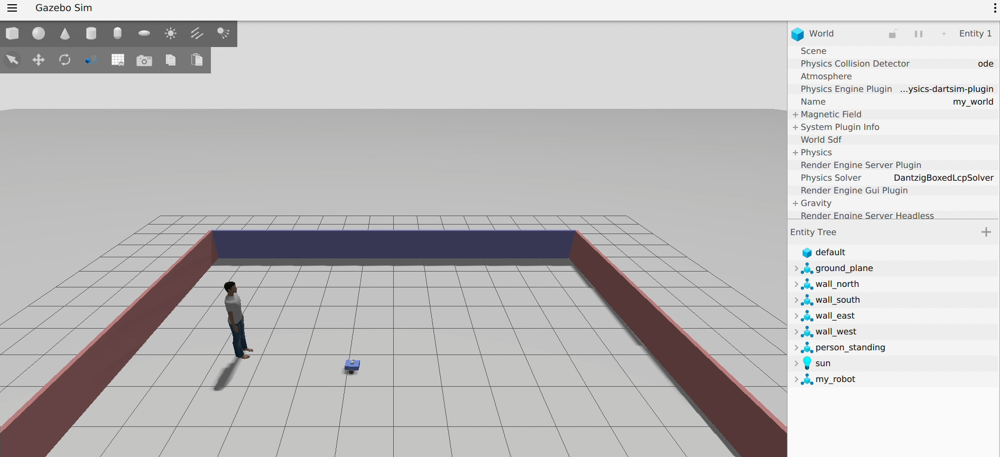
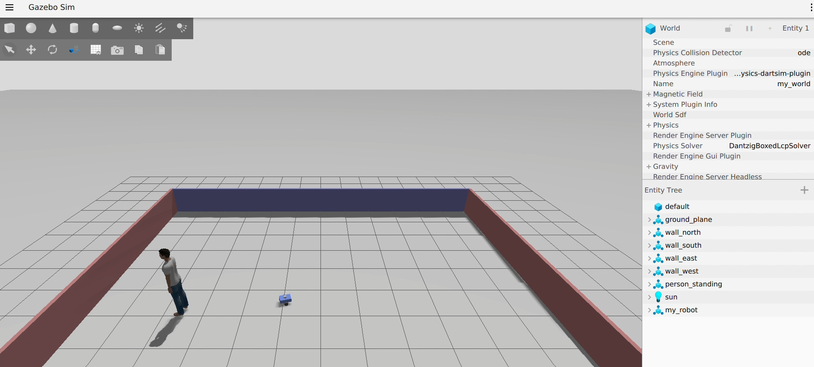

# Predictive Autonomy Stack with VIO (ROS 2 Jazzy)

A differential-drive robot patrols a simulated factory hall full of moving people and a tugger cart. It localizes without GPS (LiDAR, camera, IMU and wheels), tracks every moving agent, forecasts where each one is heading, plans around those forecasts with Nav2, and sends every velocity command through a safety gate. It runs fully on its own: no goals from a human, no stops waiting for approval.

Built with ROS 2 Jazzy and Gazebo Harmonic on Ubuntu 24.04 (WSL2).

<p align="center">
  
  
</p>

**Demo video:** _link_

---

## What happens in the demo

- **The hall:** 20 x 15 m with a main aisle, a zebra crossing, a cart lane, three pillars, benches, racks and a fenced robot cell.
- **Agents:** three pedestrians and a tugger cart move the whole time. One person uses the zebra crossing, one crosses the aisle anywhere, and one works at the assembly benches. The cart drives its lane and waits at crossings when a person is close. The agents also react to the robot: they wait, and if the robot is stuck in front of them, they step aside.
- **The patrol:** the robot drives a loop over four stations (assembly, loading bay, charging, QA cell). If a leg fails, it clears the costmaps and retries up to 3 times. Every leg is logged to CSV with the time, the number of attempts, the closest distance to any agent, and the time spent in each safety state.

## Results

**Patrol** (2 laps, 11 Oct, all agents moving, VIO on; this is the run in the demo video):

| Lap | Station | Result | Attempts | Sim time | Closest agent |
|---|---|---|---|---|---|
| 1 | assembly | reached | 1 | 37.7 s | 0.78 m |
| 1 | loading_bay_1 | reached | 1 | 62.8 s | 0.91 m |
| 1 | charging | reached | 3 | 49.3 s | 1.60 m |
| 1 | qa_cell | reached | 3 | 74.5 s | 0.93 m |
| 2 | assembly | reached | 2 | 42.1 s | 1.38 m |
| 2 | loading_bay_1 | failed, mission moved on | 3 | 26.9 s | 1.42 m |
| 2 | charging | reached | 2 | 54.7 s | 0.90 m |
| 2 | qa_cell | reached | 1 | 83.3 s | 0.89 m |

7 of 8 legs reached. No agent came closer than 0.78 m, and the safety gate never went into HOLD (1.7 s of SAFE_STOP in total). Before the agent fix (agents judged the robot by drifting odometry) the closest approaches in the same patrol were 0.09 to 0.31 m.

Open issue: several attempts failed within a few seconds without Nav2 recoveries. The cause isn't confirmed yet. The retry logic carried the mission through, but on 9 Oct, before the VIO and agent changes, all four legs of a lap succeeded on the first attempt.

**Odometry drift** (`tools/drift_test.py`). The robot drives a 3 x 3 m square, 12 m in total. The wheel radius is deliberately set 10% wrong, and drift is measured against LiDAR localization on the saved map:

| Heading source | Visual odometry | Worst position error | Heading error at end |
|---|---|---|---|
| wheels | off | 0.92 m | -21.0 deg |
| wheels | on | 0.75 m | -16.3 deg |
| gyro | off | 0.44 m | -0.2 deg |
| gyro | on (with lag smoothing) | 0.42 m | -0.6 deg |

The big gain came from a fusion config fix: heading now comes from the gyro, not the wheels. With correct wheels, the EKF heading error over two full spins went from +4.6 deg to -0.1 deg (`tools/odom_check.py`). Loosely coupled visual odometry gave no clear gain on top of wheels plus gyro in this test (0.42 against 0.44 m, which is inside the noise of the reference). These are single runs.

---

## Architecture

```
Sensors        2D LiDAR (20 m), RGB-D camera (640x480, 10 Hz), IMU, wheel encoders
   |
Localization   robot_localization EKF
                 wheels: x, y (differential)   gyro: yaw rate   visual odometry: x, y, yaw (rtabmap)
               slam_toolbox localization on the saved map: map -> odom
   |
Perception     /fused_objects (positions of people and carts in the map frame)
   |
World model    one Kalman filter per agent (constant velocity) + 5 s forecast with growing uncertainty
   |
Planning       Nav2: NavFn global planner, DWB local controller
               costmaps: static + LiDAR obstacles + forecast layer (STVL, points decay after 1 s)
   |
Safety gate    distance state machine on the nearest agent, direction aware
   |
Robot          ros2_control diff_drive_controller
```

Every stage is a separate node connected by topics. For example, the world model doesn't care whether `/fused_objects` comes from the simulator or from a camera-LiDAR detector.

### Visual-inertial odometry

This is loosely coupled VIO: the camera, the gyro and the wheels each measure motion on their own, and one EKF combines them.

- **Visual odometry:** rtabmap `rgbd_odometry` tracks image features in the RGB-D camera, restricted to 2D motion (`src/my_robot/config/vo.yaml`). It runs at up to the camera rate of 10 Hz, and each frame takes about 25 to 120 ms to process. (The drift tests below ran with the camera at 20 Hz, where VO managed 8 to 10 frames a second.) On its own, over two full spins it was within -1 to +3 deg of the LiDAR reference, and on 2 m straight it came out 2 to 4% short. It lost tracking 0 times.
- **Relay** (`tools/vo_relay.py`): rtabmap reports itself as far more certain than it is (about 0.3 mm), so the relay sets a realistic uncertainty (2 cm, 0.01 rad). It also skips frames where tracking was lost, ignores jumps larger than 0.15 m or 0.3 rad between frames, and republishes on `/vo/odom_ekf`.
- **Fusion:** the EKF takes x, y and yaw changes from VO, yaw rate from the gyro, and x, y changes from the wheels. VO measurements arrive 150 to 200 ms late, so `smooth_lagged_data` keeps 1 s of history and replays them in the right order.
- **What it bought:** see the drift table. With heading from the wheels, VO cut drift by about 20%. Once the gyro owns the heading, loose VO fusion adds no clear gain in this hall, where the LiDAR always has walls and pillars to match. The case it is meant for, a long featureless aisle or slipping wheels, has not been tested yet.

### Predictive world model (`tools/world_model_node.py`)

Each detection is associated with a track (nearest neighbour inside a 1 m gate) and updated by a constant-velocity Kalman filter. The forecast rolls the prediction 10 steps of 0.5 s ahead with no measurements, so the covariance grows at every step and the forecast widens the further out it goes. `prediction_costmap_bridge.py` turns the first part of each forecast into a point cloud for a separate STVL costmap layer. The robot plans around where a person is going, not only where they are. The points decay after 1 s, so an old forecast never leaves a ghost obstacle.

### Safety gate (`tools/safety_gate.py`)

The gate sits between Nav2 and the wheels and looks at the nearest tracked agent:

| State | Distance | Behaviour |
|---|---|---|
| AUTONOMOUS | > 1.5 m | commands pass unchanged |
| DEGRADED | < 1.5 m | speed scaled to 40% |
| SAFE_STOP | < 0.9 m | no motion towards the agent. Turning, backing off and moving past are allowed at half speed |
| HOLD | < 0.5 m | like SAFE_STOP. Releases by itself once the zone has been clear for 1 s |

The direction-aware rule exists because a plain "stop when close" made the robot and a person wait for each other forever. A supervised mode (`REQUIRE_APPROVAL = True`) makes HOLD wait for `ros2 service call /safety/approve std_srvs/srv/Trigger`.

This gate is an extra software layer, not a safety function. A real robot needs a certified safety laser scanner and a hardwired e-stop (ISO 3691-4).

---

## Problems found by measuring

| Symptom | Cause (measured) | Fix |
|---|---|---|
| SLAM map smeared and doubled | the controller's reported twist was 6% high, so the EKF over-counted turns | fuse the wheel pose in differential mode instead of the twist |
| map still smeared at starts and stops | robot pitched back 19.5 deg on acceleration (only a front caster) | rear caster and low caster friction: pitch now 0.01 deg |
| all Nav2 servers died at start (exit -6) | YAML aliases in the generated nav2_params.yaml, which the rcl parser rejects | dump without aliases, plus a CI test |
| robot stopped by forecasts that were no longer valid | forecasts written into the obstacle layer stayed there | separate STVL layer with 1 s decay |
| robot and person froze facing each other | the gate blocked every motion, including backing off | direction-aware SAFE_STOP / HOLD |
| 21 deg heading drift with miscalibrated wheels | the EKF followed wheel yaw and mostly ignored the gyro | heading from the gyro only |
| visual odometry had almost no effect | VO messages arrive 150 to 200 ms late, and the EKF dropped them | `smooth_lagged_data` with 1 s history |
| people walked into the robot (closest 0.09 m) | the simulated agents judged the robot by its odometry, which had drifted 1.6 m from the map | agents use the LiDAR-corrected map position (TF map -> base_footprint) |
| Gazebo at 18% of real time, RViz and Gazebo freezing | WSL drew everything on the CPU (`llvmpipe`), not the RTX 2070 | `GALLIUM_DRIVER=d3d12`, fewer Gazebo pose calls, camera 20 -> 10 Hz: CPU about 78% idle, real time factor about 0.37 |

---

## Running it

```bash
cd ~/autonomy
colcon build --symlink-install
source install/setup.bash

# full stack: Gazebo, EKF, SLAM localization, VO, Nav2, world model, safety gate, agents, RViz
ros2 launch src/my_robot/launch/bringup_all.launch.py

# after about 45 s, start the patrol (or pass use_mission:=true above)
python3 tools/mission_runner.py --laps 2
```

| Launch argument | Default | Meaning |
|---|---|---|
| `use_agents` | true | move the people and the cart, publish `/fused_objects` |
| `use_predictions` | true | feed forecasts into the costmaps |
| `use_vo` | true | run rtabmap visual odometry and fuse it in the EKF |
| `use_mission` | false | start the patrol from the launch file |

Mission logs go to `logs/mission_<time>.csv`.

**Measurement tools** (run with only part of the stack up, see each file's header):

- `tools/odom_check.py`: two spins and 2 m straight. Compares wheels, IMU, EKF and VO against LiDAR scan alignment.
- `tools/tilt_check.py`: pitch and roll during hard starts and stops.
- `tools/drift_test.py --label NAME`, then `tools/drift_summary.py`: the drift table above.
- `tools/set_wheel_error.py 1.10` / `1.0`: puts in a wheel calibration error, and removes it again.

On WSL2, check `glxinfo -B`. If the renderer is `llvmpipe`, add `export GALLIUM_DRIVER=d3d12` and `export MESA_D3D12_DEFAULT_ADAPTER_NAME=NVIDIA` to `~/.bashrc`.

Paths in `bringup_all.launch.py` point to `/home/vasu0/autonomy`. Change `HOME` there if your checkout is somewhere else.

---

## Tests and CI

GitHub Actions (`.github/workflows/ci.yml`) runs three jobs on every push and pull request:

- **test:** pytest inside the `ros:jazzy-ros-base` container. Covers the Kalman tracker and forecast, the safety gate states and escape rule, the VO relay maths, and the layout rules (stations at least 2 m from every agent route). It also has config regression tests for the bugs in the table above: no YAML aliases, heading from the gyro, lag smoothing on, no wheel error left in `controllers.yaml`.
- **lint:** flake8. Syntax errors and undefined names fail the build, and style issues are only reported.
- **security:** bandit (medium and high severity fail) and pip-audit on `requirements.txt`.

CI doesn't run the simulation. The end-to-end checks are the patrol logs and the measurement tools.

---

## Repository layout

```
src/my_robot/         URDF, Gazebo world and textures, launch files, config (EKF, controllers, Nav2, SLAM, VO)
src/robot_perception/ camera-LiDAR fusion node (YOLOv8n), used outside the sim demo
maps/                 saved factory map (slam_toolbox serialized + pgm)
tools/                runtime nodes: world_model_node, prediction_costmap_bridge, safety_gate, cmd_vel_bridge,
                      vo_relay, sim_agents, mission_runner
                      world building: factory_layout (single source of truth), make_factory_world
                      measurement: odom_check, tilt_check, drift_test, drift_summary
tests/                pytest suite used by CI
logs/                 drift test logs behind the results table
```

## Limits and next steps

- **Detections come from the simulator.** `sim_agents.py` publishes agent positions with 5 cm noise in the same format the camera-LiDAR fusion node uses. YOLO on Gazebo's synthetic people was not reliable enough to test the layers behind it.
- **VO is loosely coupled.** A tightly coupled VIO (OpenVINS, VINS-Fusion), or weighting VO by its own reported uncertainty, is the next step.
- **Tools run as scripts.** For a real robot they would become an ament_python package with entry points, a robot launch that swaps Gazebo for hardware drivers, `use_sim_time` as a parameter, and a Docker image built in CI.
- **Sensor time sync.** On hardware all sensors need one clock (PTP or chrony).
- **Security.** SROS2 (DDS authentication and encryption) is not set up yet.

This is a simulation demonstrator, not certified robot software.
